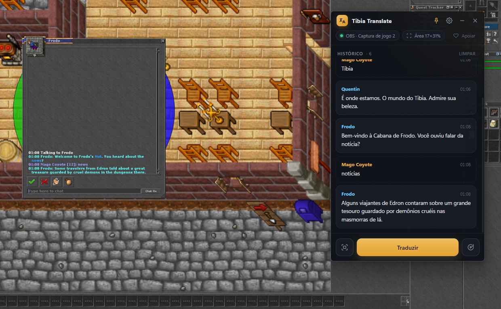
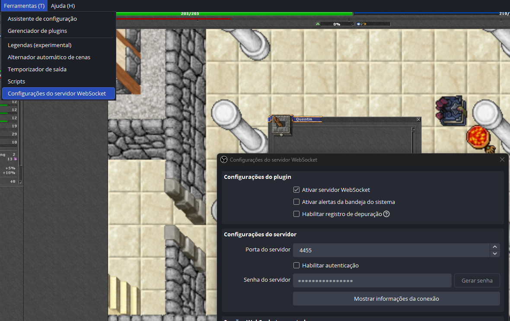
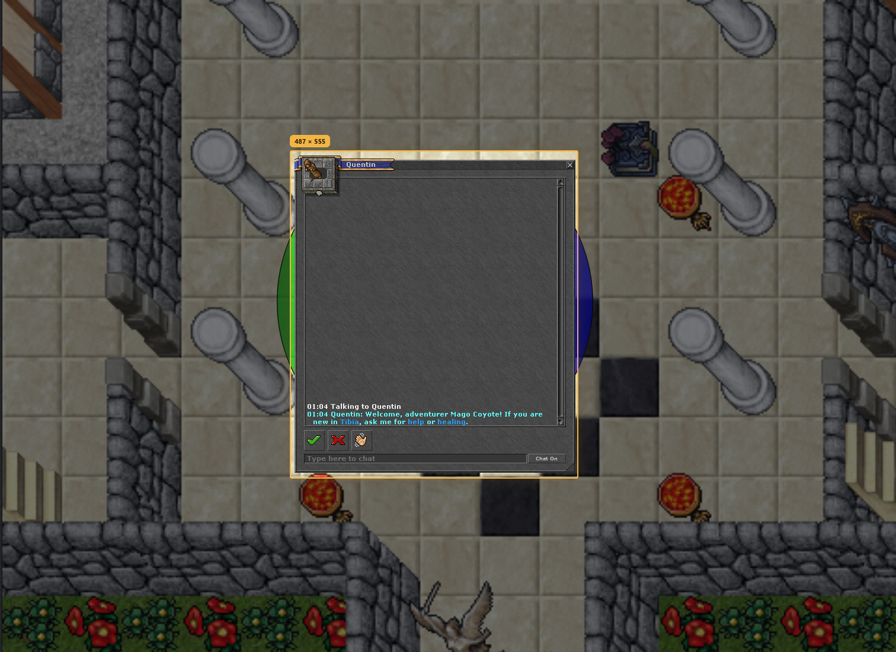

<p align="center">
  
</p>

<h1 align="center">Tibia Translate</h1>

<p align="center">
  Traduza as falas dos NPCs do Tibia em tempo real, sem sair do jogo.<br />
  Ideal para quem quer aprender inglês jogando ou mergulhar na história do Tibia.
</p>

<p align="center">
  <a href="https://github.com/adrhardtke/tibia-translate-releases/releases/latest"><b>⬇ Baixar a última versão</b></a>
  &nbsp;·&nbsp;
  <a href="https://livepix.gg/adhardtke">♡ Apoiar o projeto</a>
</p>

<p align="center">
  
</p>

---

## Downloads

| Sistema | Arquivo |
|---|---|
| **Windows 10/11** | [TibiaTranslate-Windows-Setup.exe](https://github.com/adrhardtke/tibia-translate-releases/releases/latest/download/TibiaTranslate-Windows-Setup.exe) |
| **macOS** (Apple Silicon M1/M2/M3/M4) | [TibiaTranslate-macOS-arm64.dmg](https://github.com/adrhardtke/tibia-translate-releases/releases/latest/download/TibiaTranslate-macOS-arm64.dmg) |
| **macOS** (Intel) | [TibiaTranslate-macOS-x64.dmg](https://github.com/adrhardtke/tibia-translate-releases/releases/latest/download/TibiaTranslate-macOS-x64.dmg) |
| **Linux** (qualquer distro) | [TibiaTranslate-Linux-x86_64.AppImage](https://github.com/adrhardtke/tibia-translate-releases/releases/latest/download/TibiaTranslate-Linux-x86_64.AppImage) |
| **Linux** (Debian/Ubuntu) | [TibiaTranslate-Linux-amd64.deb](https://github.com/adrhardtke/tibia-translate-releases/releases/latest/download/TibiaTranslate-Linux-amd64.deb) |

Versões anteriores estão na página de [Releases](https://github.com/adrhardtke/tibia-translate-releases/releases).

## Como funciona

1. O app fica **sempre por cima do jogo**, numa janela pequena.
2. Ele pega a imagem do jogo pelo **OBS Studio** (o Tibia bloqueia prints comuns, que saem pretos).
3. Lê a janela de chat do NPC e mostra **só a tradução**, com um histórico das falas.

Aperte **Traduzir** ou use o atalho **Ctrl+Shift+T** sem tirar o foco do jogo. Também dá para
ligar a tradução automática.

## Primeiros passos

1. Instale o [OBS Studio](https://obsproject.com/) (grátis).
2. No OBS, adicione uma fonte **Captura de jogo** ou **Captura de janela** apontando para o Tibia.
3. No OBS, vá em **Ferramentas → Configurações do servidor WebSocket** e marque
   **Ativar servidor WebSocket**. A porta padrão é `4455`. Se **Habilitar autenticação**
   estiver marcado, copie a senha.

   

4. Abra o Tibia Translate, clique na engrenagem ⚙, informe a senha (se houver) e clique em
   **Conectar**.
5. Escolha a **fonte do jogo** e clique em **Definir área**: um print do jogo aparece em tela
   cheia. Arraste sobre a janela de conversa com o NPC e pressione **Enter**.

   

6. Fale com um NPC e clique em **Traduzir**. Pronto!

> Deixe o Tibia em modo **janela** ou **tela cheia sem bordas**. Em tela cheia exclusiva
> nenhum programa consegue ficar por cima do jogo.

## Avisos de segurança na instalação

O app ainda não tem certificado de assinatura digital (é caro para um projeto independente),
então o sistema pode mostrar um aviso na primeira vez.

**Windows:** se aparecer "O Windows protegeu o computador", clique em **Mais informações →
Executar assim mesmo**.

**macOS:** se aparecer que o app "está danificado" ou "não pode ser aberto", arraste o app
para a pasta **Aplicativos** e rode no Terminal:

```bash
xattr -cr "/Applications/Tibia Translate.app"
```

**Linux (AppImage):** dê permissão de execução antes de abrir:

```bash
chmod +x TibiaTranslate-Linux-x86_64.AppImage
./TibiaTranslate-Linux-x86_64.AppImage
```

## Perguntas frequentes

**É seguro? Vou ser banido?**
O Tibia Translate não lê a memória do jogo, não mexe no cliente e não automatiza nenhuma ação.
Ele só lê a imagem que o OBS já captura, como uma gravação de tela.

**Preciso pagar pela tradução?**
Não. O app usa serviços de tradução gratuitos e o reconhecimento de texto roda no seu computador.

**As imagens do jogo são salvas?**
Não. A imagem fica só na memória durante a leitura e é descartada em seguida.

## Apoie

Se o Tibia Translate te ajuda, considere apoiar o desenvolvimento:
**[livepix.gg/adhardtke](https://livepix.gg/adhardtke)** ♡

---

<sub>Tibia é marca registrada da CipSoft GmbH. Este projeto não é afiliado nem endossado pela CipSoft.</sub>
